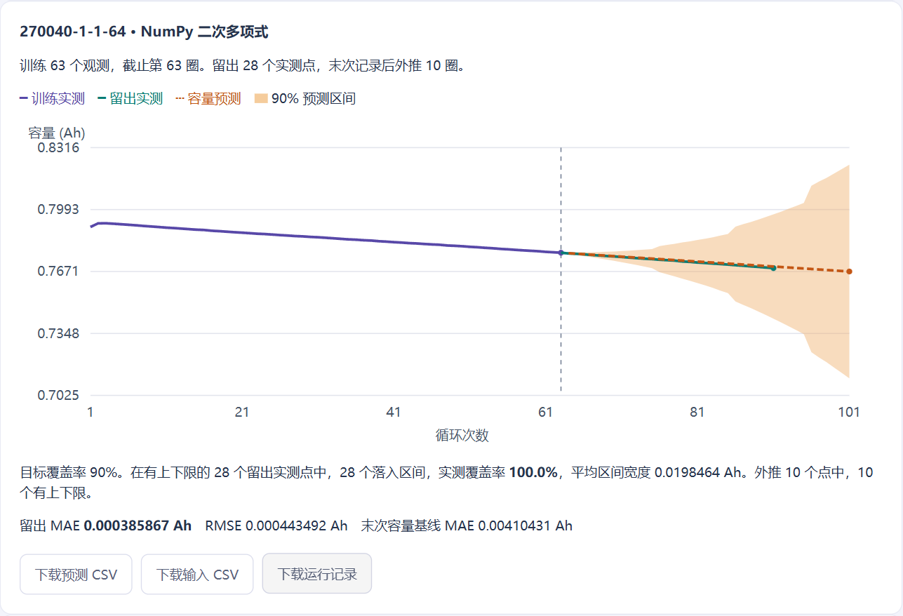
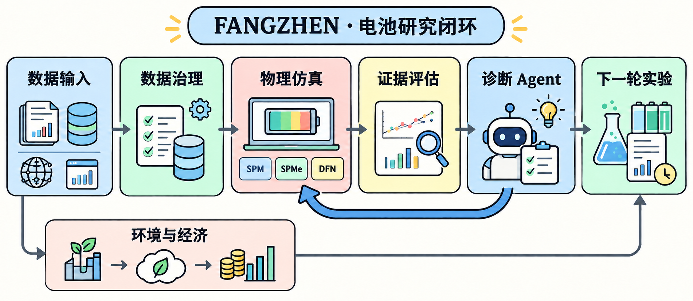
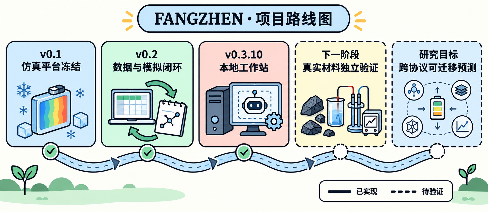

# 🔋 Fangzhen · 电池数据—模型研究工作站

Fangzhen 是在本机浏览器中运行的锂电与钠电研究工作站。当前版本 `v0.3.25` 可以读取公开钠电池的循环数据，用早期放电容量预测后续容量曲线，并给出逐圈预测区间。平台也支持 PyBaMM 电化学仿真、阻抗谱（EIS）分析、BMS 状态估计与充电控制仿真。

[快速开始](#快速开始) · [钠电池容量衰减预测](#钠电池容量衰减预测) · [接入数据与算法](#接入数据与算法) · [项目能力](#项目能做什么) · [研究流程](#研究流程) · [路线图](#项目路线图) · [验收状态](STATUS.md)

## 快速开始

克隆仓库后，在仓库根目录用 Python 3.11 或更高版本运行以下命令。第一行安装下方案例使用的 NumPy。选择内置的「线性趋势」「平方根趋势」或「末次容量基线」时，可以直接运行第二行。

```powershell
python -m pip install numpy
python -m user_tools.research_workbench
```

工作站会自动打开本机浏览器。Windows 用户也可以双击 `启动科研工作站.bat` 启动。钠电容量预测直接在本机 Python 中运行。PyBaMM 半电池案例的环境和命令见下文。[物理仿真与扩展环境](#物理仿真与扩展环境)

## 钠电池容量衰减预测

仓库附带 BatteryLife、NIMS 和 NFM 三套可直接使用的容量表，共 **143 条轨迹、84,347 个放电容量观测**。BatteryLife 和 NIMS 保留原始循环编号，NFM 按原工作表的观测顺序排列。[容量表与来源记录](data/public/capacity_curves) · [各表的提取方法与许可](docs/sodium_capacity.md#已接入的逐循环容量)

1. 打开左侧「容量衰退预测」，在「逐循环数据」中选择 BatteryLife，再选择轨迹 `270040-1-1-64`。
2. 选择「NumPy 二次多项式」，把「训练截止循环」设为 `63`，「末次实测后外推圈数」设为 `10`，保留默认的 `90%` 预测区间，点击「预测容量」。



模型用第 1–63 圈拟合。第 64–91 圈的 28 个留出实测值全部落在区间内。第 92–101 圈是末次实测之后的外推，第 92 圈的容量预测为 **0.7694 Ah**，区间为 **0.7406–0.7982 Ah**。页面可下载输入数据、逐圈结果和含算法版本的运行记录。[逐圈预测 CSV](outputs/sodium_capacity_forecast/区间90_270040-1-1-64.csv) · [本次运行 JSON](outputs/sodium_capacity_forecast/区间90_270040-1-1-64.json)

对 BatteryLife 的 69 条文件轨迹分别用最早约 70% 的观测训练，在同一轨迹的后续实测点上回测。相同算法在 90% 目标水平下覆盖了 3,990 个留出点中的 3,494 个，按点计算的实测覆盖率为 **87.6%**。[逐轨迹回测 CSV](outputs/sodium_capacity_forecast/区间90_逐轨迹回测.csv)

### 接入数据与算法

| 模块 | 输入 | 输出 |
| --- | --- | --- |
| 数据接入 | 选择现有容量表，或导入 UTF-8 CSV，表头为 `cell_id,cycle,capacity_Ah` | 每条轨迹按循环号或观测序号排列的放电容量，单位 Ah |
| 容量预测 | 单条轨迹的训练循环号、训练容量和待预测循环号 | 按目标循环顺序返回容量预测值，单位 Ah |
| 区间与回测 | 用训练段的历史预测误差估计 80%、90% 或 95% 区间，用留出实测容量评分 | 逐圈上下限、留出 MAE、RMSE 和实测覆盖率。某个预测跨度的校准数据不足时，该跨度仅输出点预测 |

要添加预测算法，在算法包中通过 Python 入口点 `fangzhen.capacity_forecasters` 注册预测函数，把包安装到工作站使用的 Python 环境，刷新页面即可选择。要添加数据，可从「导入容量 CSV…」试用新表，也可把标准表加入数据目录供后续调用。[数据与算法接入示例](docs/sodium_capacity.md#接入新数据与算法) · [34 条钠电公开数据来源](configs/sodium_public_sources.json)

## EIS 与 BMS

- **电芯模型与状态估计：** 支持等效电路的电压回放和库仑计数、EKF 等状态估计；公开数据案例分别记录开环电压和使用电压反馈后的估计结果。
- **EIS 与 HPPC：** 对阻抗谱进行筛查与电路拟合，比较 HPPC 单独辨识、EIS 初始化及联合辨识；结果包括参数、窗口指标、逐点轨迹和报告。EIS 进入时域模型前仍需检查采集条件与参数适用范围。
- **公开数据案例：** Stanford W8 后续动态记录和 W5 逐电芯标定案例使用冻结的 HPPC 模型进行开环回放；CALB 60129 的 EIS 对照属于回顾性探索，当前未显示稳定的 EIS 增量收益。[案例说明](docs/stanford_frozen_delivery_20261029.md) · [CALB 对照](docs/eis_hppc_incremental_validation_20261029.md) · [诊断记录](docs/eis_mpc_diagnostics_20261029.md)
- **充电控制：** 具备 MPC 和电芯模型的仿真闭环，以及合成条件下的 CC–CV 对照；失配条件下的 SOC 估计和拖尾仍需改进，尚未完成实物充电或硬件在环验证。
- **钠电与材料研究：** 提供钠离子电池模型、硬碳性能预测和多目标优化的研究入口；实际材料和不同电芯的预测能力仍需对应实验数据与独立验证。[钠电说明](docs/sodium_dfn_hardcarbon_soh_20261029.md)

已知边界：Stanford W8/W9 的 EIS 尚未通过当前桥接筛查；模型尚未完成统一的低温、跨电芯与真实设备验收。项目不把单个数据集上的结果视为对所有电芯的保证。

本轮增加商用Panasonic PF单体的0/10/25°C参数表、上一循环容量/阻抗更新、增广EKF，以及更新参数→MPC→虚拟CAN。7条新评分工况的逐记录平均电压RMSE为61.31→37.55mV；10段老化历史回归为147.99→42.19mV。EIS全谱严格筛查12/14通过，12项软件故障保护用例通过。最差温度RMSE仍为5.44°C，实物设备尚未连接。[本轮结果和剩余差距](docs/adaptive_pf_v0314_20261029.md)；[四项目、寿命基线与v0.3.13历史验证](docs/frontier_commercial_validation_v0313_20261029.md)。

## 项目能做什么

| 研究环节 | 已有能力 | 关键约束 |
| --- | --- | --- |
| **实验数据** | 数据集适配、协议与单位核对；本地工作站的方案、样品、工艺、表征、极片与半电池记录；Excel/CSV 导入和版本归档 | 原始数据、来源和测试条件必须由研究者提供，软件不补造缺失实测值 |
| **电化学仿真** | 基于 PyBaMM 的 SPM、SPMe、DFN 回放；公开案例、参数敏感性和固定窗口比较 | 尺度、几何、初态和协议需要先核对；低误差不等于参数可辨识或跨材料有效 |
| **电池工程仿真** | 电热ECM、SOX CC/EKF/UKF/增广EKF、MPC、电池包、寿命/故障基线、PyProBE、虚拟CAN和12种选点入口；MOBO-OSD、rMFBO、CAMO、BatteryLife；PF跨温度参数表与上一循环更新、保护逻辑SIL | 同一单体新工况与老化回归分别计分；低温热模型、跨电芯、实际仪器/BMS联调仍待补齐；[本轮结果与差距](docs/adaptive_pf_v0314_20261029.md) |
| **EIS诊断** | 阻抗谱导入、单位冗余核对、含/不含低频串联电容的Lin-KK、独立SVD复算、1RC/2RC拟合、叠图与结果下载 | 原始全谱保留，2条谱阶数诊断与5个幅值字段异常点待查；用于BMS前需要SOC/温度与脉冲验证 |
| **仿真诊断 Agent** | 在声明范围内探索扩散系数与交换电流密度倍率；记录每轮候选、失败原因和曲线；支持规则策略与可选兼容模型 API | Agent 只提出候选，物理任务与数据用途检查仍由平台执行；目前没有真实材料前瞻验证 |
| **描述符与实验闭环** | 分组验证、有限候选模型建议、多目标探索、待实验记录与实验反馈 | 公开/合成回放是方法验收，建议必须经新的独立实验检验 |
| **环境与经济** | 用户工艺清单、Brightway 前景 GWP 计算、成本核算和来源留档；独立的 EverBatt 社区迁移参考案例 | 按声明边界和功能单位筛选；尚非完整背景数据库 LCA 或资本现金流 TEA |

工作站默认监听本机 `127.0.0.1`，个人方案与作业记录保存在本机 `data/`。物理仿真任务使用配置好的 WSL/PyBaMM 环境。[工作站文档](docs/workbench_v038.md) · [Agent 接入说明](docs/battery_agent_adaptation.md) · [环境与经济评价](docs/workbench_v036.md)

## 研究流程

数据能否进入模型、模型输出能否支持结论，在流程里是两道不同的关。诊断或 Agent 发现问题时回到数据与实验设计，而不是直接把最低误差写成验证结论。



[查看高清原图](figures/research-loop-illustrated.png) · [可编辑的 Mermaid 流程图](figures/research-workflow.md) · [Mermaid 源码](figures/research-workflow.mmd)

图中的“下一轮实验”带时钟，表示待开展的计划。**公开数据回放**检验软件通路，**参数诊断**发现模型和数据哪里不一致，**独立实验**才检验结论能否迁移到新样品。碳足迹与成本使用另一套明确的工艺清单，不能与不同功能单位的参考结果混算。

## 物理仿真与扩展环境

### PyBaMM 半电池示例

仓库中的 `examples/half_cell_demo/` 包含运行此示例所需的实验数据。先配好 WSL Ubuntu 的 `pybamm` 环境，再从仓库根目录运行下面的命令。[安装指南](HANDOFF.md)

```bash
python -m user_tools.import_dataset --package examples/half_cell_demo
python -m user_tools.run_baseline --package examples/half_cell_demo --models DFN
```

第一条命令校验并导入实验 CSV，第二条运行使用原始参数的 DFN 基线。准备好相应的本地数据后，也可以列出数据集或按 YAML 配置运行流水线。

```bash
python run_pipeline.py --list-datasets
python run_pipeline.py --config configs/example.yaml
```

完整测试套件中的部分用例还需要另行准备原始数据。[测试环境与验收状态](STATUS.md)

### 工作站扩展

Windows 打包命令是 `./user_tools/build_workbench.ps1`，生成的 EXE 保存在本机 `outputs/`。启动脚本优先运行工作区源码，Python 环境不可用时会尝试本机已有的打包版。工作站的物理仿真和部分机器学习任务使用 WSL，Excel 导出及环境经济分析还需各自的本机依赖。[工作站说明](docs/workbench_v03.md) · [环境与经济说明](docs/workbench_v036.md)

工程仿真和 EIS 功能按需安装 `requirements-engineering.txt`、`requirements-eis.txt` 所列依赖。Windows 可从 `安装工程仿真扩展.bat` 进入安装流程。工程案例的大体积原始数据按各来源说明准备。Stanford OSF 若要求 view-only 参数，在本机环境变量 `STANFORD_OSF_VIEW_ONLY` 中填写。[工程引擎与固定版本](docs/engineering_integrations_v0312_20261029.md)

在“仿真诊断与参数探索”中可直接用规则策略。若使用可选模型服务，展开“模型API地址与端口”，填写基础地址（例如 `http://localhost:11434/v1`）、模型名和可选密钥，保存后检查接口。配置写入本机忽略文件 `data/agent_llm.local.json`；界面检查 `/models`，实际建议任务从 WSL 调用 `/chat/completions`，两者需分别保证可达。详见 [Agent 接入说明](docs/battery_agent_adaptation.md)。

v0.3.11 新增了 EIS 谱诊断与 RC 参数拟合。可用 [合成演示谱](examples/eis_rc_demo/README.md) 检查软件通路；[GitHub 接入选择与操作说明](docs/github_battery_integrations_20261029.md)说明本轮交付及后续 thevenin、PyProBE、电池包和 BMS 硬件路线。

## 项目路线图

实线阶段表示软件已经实现；虚线阶段是还需要真实材料数据与独立实验的研究目标，没有把未来目标写成已验收能力。



[查看高清原图](figures/project-roadmap-illustrated.png) · [可编辑的 Mermaid 路线图](figures/project-roadmap.md) · [Mermaid 源码](figures/project-roadmap.mmd)

| 阶段 | 可检查的交付 | 当前结论 |
| --- | --- | --- |
| **v0.1 冻结平台** | 数据适配、参数来源矩阵、尺度对齐门、PyBaMM 回放与报告 | 冻结标签 `v0.1.0-platform`；详见[预注册判据](docs/preregistration_2026-09-18.md) |
| **v0.2 模拟闭环** | Excel 研究任务、受控约束、公开/合成回放、模拟工艺比较 | 软件闭环通过；[验收报告](docs/v02_simulation_loop.md)保留科学失败门 |
| **v0.3.11 本地工作站** | 数据版本、仿真诊断、描述符/多目标研究、清单评价与本机 API 配置 | 已完成工程接入；[Agent 说明](docs/battery_agent_adaptation.md)与[状态页](STATUS.md)列明限制 |
| **v0.3.25 钠电容量预测** | 三套容量表、可切换的预测算法、逐圈预测区间及 CSV/JSON 导出 | BatteryLife 同轨迹留出回测已完成。[复现说明](docs/sodium_capacity.md) |
| **下一阶段** | 真实材料数据、独立协议/批次、前瞻实验和来源完整的环境清单 | 待采集与验证；不能由软件演示结果代替 |

## 复现与判断边界

- **输入来源可追踪**：样品、实验协议、数据用途、单位及参数来源要留档。数据接入方法见[新增数据集](docs/adding_a_dataset.md)；运行前先看[尺度对齐门](docs/scale_alignment_gate.md)。
- **仿真与辨识分开**：zero-fit 回放、同一曲线上的参数探索、独立留出预测是不同证据等级。固定比较窗口和候选覆盖检查防止“少算一段”获得较低误差。
- **真实材料结论尚未过门**：历史 G5/G6、Chen 留出、石墨代理参数等结果和失败条件均在 [STATUS.md](STATUS.md)，不因新界面或新 Agent 上线而改变。
- **环境经济口径单列**：当前石墨清单提供声明边界内的 GWP 与成本筛选；EverBatt 参考预设使用不同原料与功能单位。文献、实现和限制见[环境与经济评价](docs/workbench_v036.md)。

## 仓库导览

```text
battery_sim/           数据集适配、模型和仿真核心
governance/            数据用途、尺度、参数来源等研究约束
identification/        参数辨识与留出预测
user_tools/rg_loop/    Excel 研究记录与模拟闭环
user_tools/workbench/  本地工作站、Agent、ML 与环境经济入口
configs/               模型、化学体系和数据集配置
examples/              可随仓库复现的最小案例
tests/                 自动化回归
docs/                  方法、版本说明与验收记录
figures/               首页图示的 Mermaid 源码与预览
```

本地实验数据、作业记录、打包程序和大体积运行结果不作为源码发布。可复现的少量历史数值产物保留在仓库中；其意义和限制由 [STATUS.md](STATUS.md) 解释。
